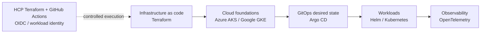

# Platform Forge

Platform engineering labs for reproducible cloud infrastructure, Kubernetes, GitOps, observability, and MLOps.

Platform Forge is a practical engineering workspace: each lab turns an architecture decision into automation, documentation, validation, and an operational runbook. The projects are designed for engineers who want to understand the trust boundaries and failure modes behind a platform, not only the final deployment command.

## What is being built now

| Workstream | Current focus | Where to start |
| --- | --- | --- |
| Cross-cloud platform | Connecting Azure AKS and Google GKE patterns through repeatable Terraform and delivery workflows | Design work is currently private |
| Google Cloud foundation | Private regional GKE, workload identity federation, HCP Terraform execution, and controlled Argo CD handoff | Infrastructure work is currently private |
| GitOps delivery | Separating infrastructure ownership from cluster desired state and application reconciliation | GitOps work is currently private |
| Observability demo | Preparing an OpenTelemetry Astronomy Shop reference deployment for platform validation | The lab is currently private |
| Azure AKS | Reusable Terraform configuration for environment-based AKS deployments | [AKS Terraform project](https://github.com/ShokryPlatForge/terraform-azure-aks-clusters-project) |

Some workstreams are private while they are being validated. Public repositories are sanitized reference material; they do not contain credentials, cloud state, or personal lab endpoints.

## Architecture at a glance

## Engineering principles

- **Reproducible:** infrastructure and application state are reviewable in Git.
- **Least privilege:** federation and short-lived credentials are preferred over stored cloud keys.
- **Explicit ownership:** Terraform provisions foundations, GitOps reconciles workloads, and operators retain a clear recovery path.
- **Observable by design:** metrics, traces, logs, and useful runbooks are part of the platform work.
- **Cost-aware:** lab environments include profiles, quotas, and destroy paths so experiments remain deliberate.

## Explore the work

- Start with the [AKS Terraform project](https://github.com/ShokryPlatForge/terraform-azure-aks-clusters-project) for a public, runnable infrastructure example.
- Read the [organization repositories](https://github.com/orgs/ShokryPlatForge/repositories) to see the current public surface.
- Follow the linked project READMEs for architecture decisions, prerequisites, validation, and cleanup instructions.

## About the organization

Platform Forge is maintained by Mohamed Shokry in Egypt. The organization is a technical lab and reference space for platform engineering, cloud operations, Kubernetes, and observability.

If you are reviewing a design, finding an issue, or have a useful platform-engineering perspective, open an issue in the relevant public repository with the context, expected behavior, and evidence needed to reproduce it.
